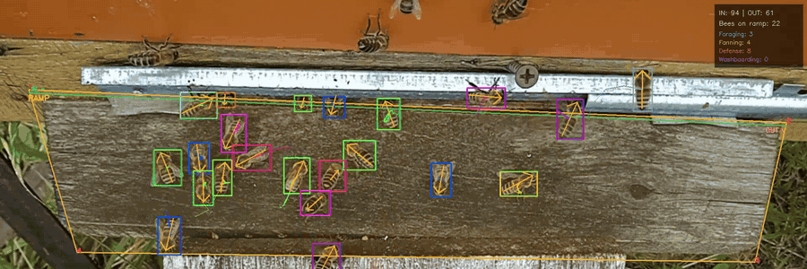
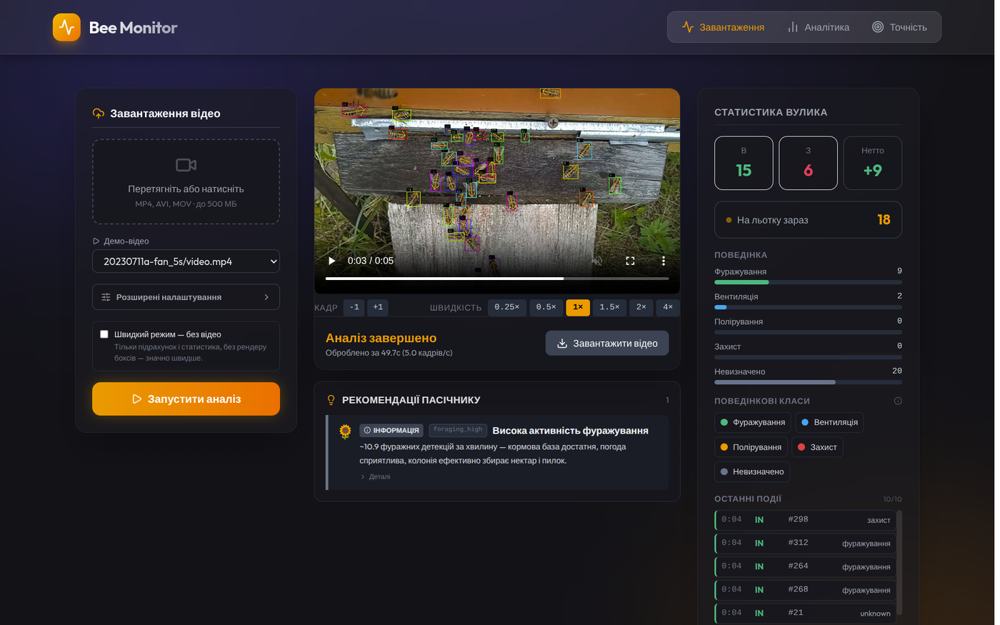
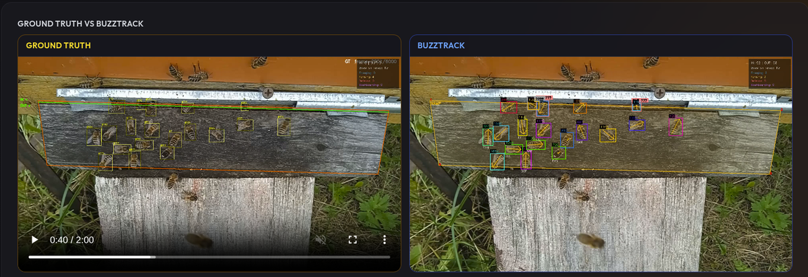
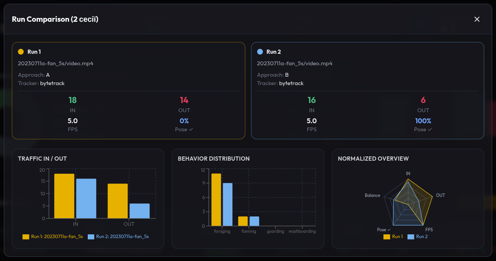
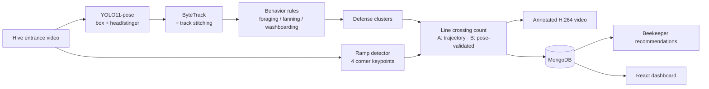
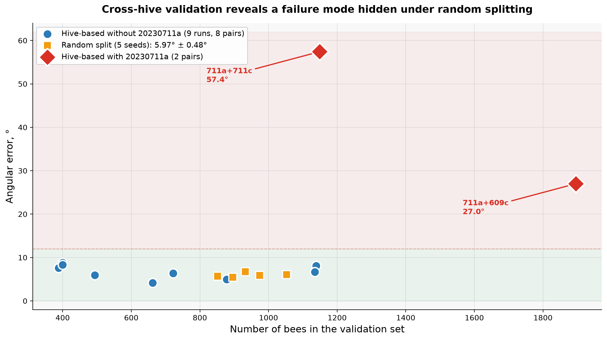
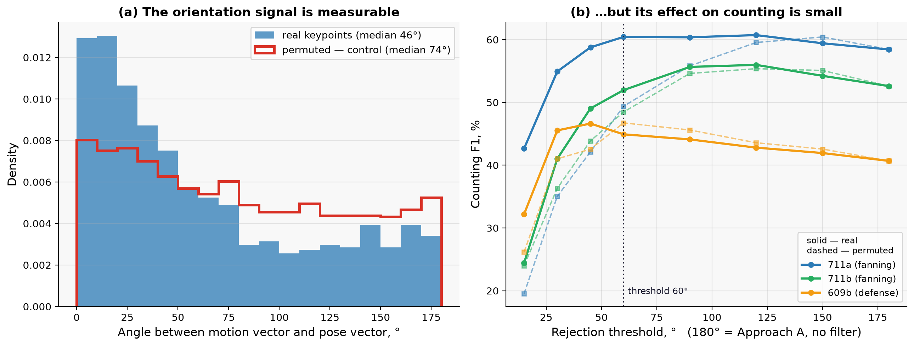

# BuzzTrack: bee traffic and behavior monitoring at the hive entrance

Computer vision system that watches a video of a beehive entrance, tracks every bee, counts how many fly in and out, and flags colony behaviors such as fanning (ventilation) and defense. Built as my bachelor's thesis at Lviv Polytechnic National University (2026) and extended into a research paper.




## Why

Opening a hive to check on a colony disturbs it and takes the beekeeper's time. Most of what matters (is the colony foraging, is it overheating, is it being robbed) is visible at the entrance. BuzzTrack turns a camera pointed at the landing board into numbers and plain-language alerts.

## What it does

- **Detects bees and their orientation** with a single YOLO11-pose model: a box plus two keypoints (head and stinger) per bee, so heading comes for free without a second network.
- **Finds the entrance automatically** with a separate keypoint model for the landing ramp (4 corners), so the counting line does not have to be drawn by hand.
- **Tracks bees** with ByteTrack plus a short-gap track stitching step.
- **Counts traffic in two ways**: A counts every crossing of the line; B additionally checks that the bee's body points in the direction it moves and keeps the rejected crossings for audit, drawn on the video as a grey "✗ pose" glow.
- **Classifies behavior** per track with rules adapted from Sledevič et al. (PLOS ONE, 2025): foraging, fanning, washboarding, plus a multi-bee defense detector (guards clustering around an intruder).
- **Evaluates itself** against an annotated ground-truth dataset: the Accuracy page scores behavior per class (precision, recall, F1, confusion matrix) next to a ground-truth video, and offline scripts in `backend/eval/` score counting (TP/FP/FN, F1, MAE), threshold sweeps and a permutation test.
- **Gives the beekeeper advice**: about a dozen deterministic rules turn the statistics into alerts like "possible overheating" or "the colony is defending the entrance".

## Screenshots

The dashboard (UI in Ukrainian): upload a video, watch it being processed, get the annotated video, hive statistics and recommendations.



| Accuracy: ground truth next to BuzzTrack's output | Analytics: Approach A versus B on the same clip |
|---|---|
|  |  |

## How it works



The backend runs this as a 7-stage pipeline (detection, tracking, track update, behavior, defense, counting, annotation) in a background job; the frontend polls live statistics while a video is processed.

## Results and findings

The model was trained on 400 annotated frames from 8 hives. Validation used whole hives the model had never seen (hive-based split), not a random split of frames.

| Model | Validation | Pose mAP@50 | Mean / median orientation error |
|---|---|---|---|
| YOLO11s-pose, imgsz 1920 | 2 held-out hives | 97.7% | 4.6° / 1.4° |

What I learned from evaluating it properly matters more than the headline number:

**1. A random split hides a failure mode.** With frames split at random, every run looks fine. Holding out whole hives shows that one hive of eight (the densest one) does not generalize from the other seven: orientation error jumps from 4–9° to 27° and 57°, while mAP drops much less. Orientation error turned out to be a more sensitive diagnostic than mAP.



**2. Pose helps counting, but only a little.** The angle between a bee's body and its motion is a real signal (median 46° versus 74° when keypoints are shuffled between bees). Using it to reject crossings (Approach B) raises counting F1, but a permutation test shows most of that gain also comes from simply discarding events: orientation itself adds about +1.8 percentage points (combined p = 0.009 over three videos). The dominant counting errors are track fragmentation and the same bee crossing the line repeatedly, where pose and motion agree anyway.



**3. Single-pass pose keeps cost flat.** Inference time of the one-stage pose model does not depend on how many bees are in the frame (correlation r ≈ −0.13 over 2 to 33 bees), whereas a detect-then-crop two-stage design grows linearly with every bee.

**Limitations.** Behavior classification is rule-based and is the weakest part: per-bee F1 for fanning ranges from 27% to 58% depending on the video. Ground-truth crossing events are derived from annotated tracks because the dataset has no crossing labels, and the dataset covers 8 hives, so the per-hive generalization result is itself a small-sample one.

## Tech stack

| Area | Tools |
|---|---|
| ML | PyTorch, Ultralytics YOLO11-pose, Supervision (ByteTrack), OpenCV, NumPy, pandas |
| Experiments | Hydra configs, MLflow on DagsHub, Kaggle GPU (T4) for training |
| Backend | FastAPI, Motor (async MongoDB), Pydantic v2, FFmpeg |
| Frontend | React 19, TypeScript, Vite, TanStack Query, Recharts, Tailwind, client generated from OpenAPI |

## Repository layout

```
backend/    FastAPI app, video pipeline, evaluation against ground truth
  services/   pipeline stages, counter, behavior rules, annotator, recommendations
  eval/       offline evaluation and diagnostics (cached detections, sweeps, permutation test)
  tests/      unit tests for counting and orientation
frontend/   React dashboard: Upload, Analytics, Accuracy pages
research/   dataset download and split, YOLO training with Hydra + MLflow, benchmarks
```

Each module has its own README with details: [backend](backend/README.md), [frontend](frontend/README.md), [research](research/README.md).

## Running locally

Requirements: Python 3.12 with [uv](https://docs.astral.sh/uv/), Node.js 20+, FFmpeg, and MongoDB (local or Atlas). A CUDA GPU is optional but makes processing much faster.

```bash
# MongoDB in a container
docker run -d --name bee-mongo -p 27017:27017 mongo:7

# Backend: http://localhost:8000/docs
cd backend
cp .env.example .env        # set MONGO_URI=mongodb://localhost:27017
uv sync
uv run uvicorn main:app --port 8000

# Frontend: http://localhost:5173
cd ../frontend
cp .env.example .env        # VITE_API_URL=http://localhost:8000
npm install
npm run dev
```

Trained weights for the bee pose model and the ramp detector are in `backend/data/models/`. Demo videos and ground truth for the Accuracy page come from the [tracking and behavior dataset](https://data.mendeley.com/datasets/8gb9r2yhfc/6) and are expected in `research/datasets/raw/tracking_and_behavior/<video>/`; the training datasets are downloaded by scripts described in [research/README.md](research/README.md).

Tests:

```bash
cd backend && uv run pytest
```

## Data and credits

- Bee pose and ramp keypoint data: Sledevič et al., [Keypoint-Based Bee Orientation Estimation and Ramp Detection at the Hive Entrance](https://doi.org/10.3390/agriculture14111890), *Agriculture*, 2024. Using the trained model for model-assisted labeling in AnyLabeling, I prepared 350 more annotated frames (kept separate from the reported training runs).
- Tracking and behavior ground truth: Sledevič & Matuzevičius, [Mendeley Data, DOI 10.17632/8gb9r2yhfc.6](https://data.mendeley.com/datasets/8gb9r2yhfc/6), described in [PLOS ONE, 2025](https://doi.org/10.1371/journal.pone.0318401). The behavior rules follow the definitions from that paper.

Thesis supervisor: Volodymyr Shymanskyi, Lviv Polytechnic National University.

## License

Code is released under the [MIT License](LICENSE). The datasets belong to their authors and are not covered by it.
